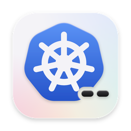
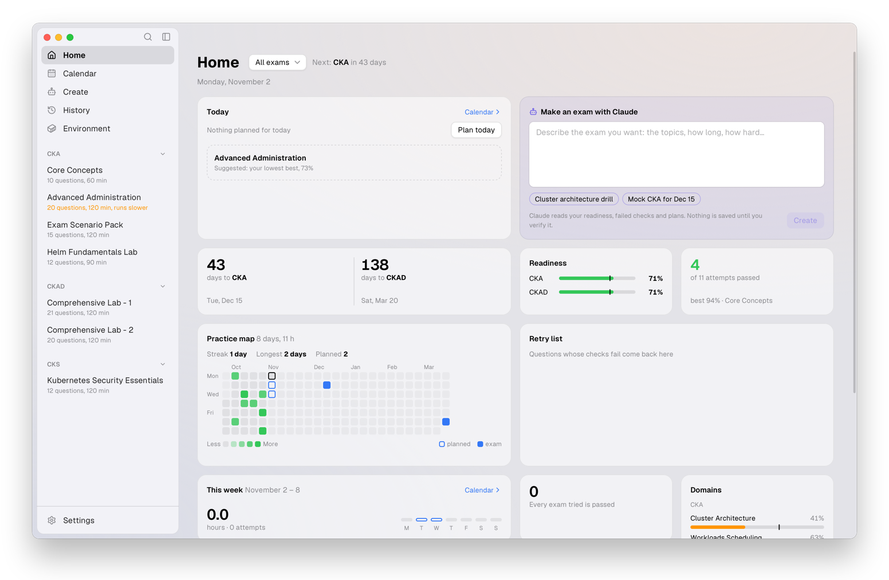

<div align="center">
  
  <h1>ckpro</h1>
  <p>Practise the CKA, CKAD and CKS on real Kubernetes clusters,<br />in a desktop laid out like the exam.</p>
  <p>
    <a href="https://github.com/dungxtd/ckpro/releases/latest"><strong>Download</strong></a> ·
    <a href="#install">Install</a> ·
    <a href="docs/ARCHITECTURE.md">How it works</a>
  </p>
  <p>
    <a href="https://github.com/dungxtd/ckpro/releases/latest"></a>
    
    <a href="https://github.com/dungxtd/ckpro/actions/workflows/ci.yml"></a>
  </p>
</div>

<p align="center">
<picture>
  <source media="(prefers-color-scheme: dark)" srcset="resources/home-dark.png" />
  
</picture>
</p>

Each attempt gets its own kind clusters, a task host to `ssh` into and a remote XFCE desktop with a terminal, Firefox (limited to the allowed documentation) and VSCodium. Tasks are graded by running their checks against the cluster.

## What's in it

- **Exam and practice**: timed and graded as on the day, or at your own pace with hints, checks and solutions.
- **Home**: the days to each exam, readiness by domain, a map of the days you practised, and what to retry.
- **Calendar**: the week, a day at a time; plan an exam or practice on any day, for CKA, CKAD and CKS at once.
- **Results**: your score, what you missed, and what to do next.
- **Create** (optional): ask for an exam in a chat; each new question is proven on a cluster before it is kept.
- **Assistant** (optional, practice only): Claude explains or explores the cluster with your OK. Never in exam mode.
- **Environment**: what uses Docker's memory and disk, with fixes.
- **Guard**: during an attempt, changes from outside the exam desktop are undone and reported.

## How is ckpro different?

Online simulators hand you a session: a few runs, a clock you did not choose, a browser tab.

- **On your computer**: real clusters as often and for as long as you like, no session to book.
- **Real Kubernetes**: kind clusters and `kubectl`, nothing emulated.
- **Laid out like the exam**: a remote desktop, the allowed docs only, a terminal and an editor.
- **Graded by checks**: you see which ones failed, and why.
- **Yours**: every feature works without AI; the assistant is opt-in and never in exam mode.

## Install

macOS or Linux, with [Homebrew](https://brew.sh) (casks on Linux need Homebrew 4.5 or later):

```bash
brew install --cask dungxtd/tap/ckpro
```

**Windows**: the installer for your PC (`ckpro_windows-x64_….exe`, or `ckpro_windows-arm64_….exe` on Windows on Arm) from the [latest release](https://github.com/dungxtd/ckpro/releases/latest). It is not signed yet: SmartScreen asks once (More info, then Run anyway).

**Linux without Homebrew**: the AppImage or the `.deb` for your machine (`linux-x64` or `linux-arm64`) from the same release:

```bash
sudo apt install ./ckpro_linux-x64_*.deb   # Debian, Ubuntu
chmod +x ckpro_linux-x64_*.AppImage && ./ckpro_linux-x64_*.AppImage
```

## Requirements

- macOS (Apple silicon or Intel), Windows 10/11 (x64, or Arm on Windows 11) or Linux (x64 or arm64, with WebKitGTK 4.1: Ubuntu 22.04 or later)
- A Docker engine with 4 GB of memory or more: OrbStack or Docker Desktop on macOS, Docker Desktop on Windows, Docker Engine on Linux (your user in the `docker` group)

That is all. Everything else runs in Docker or in the app's data directory: the clusters, task host, exam desktop and registry cache, kind and the kubeconfigs. The assistant, optional, uses Claude Code installed on the computer and its own login (with Node.js, which runs its adapter).

Your attempts, plans and settings stay on this computer, in a database encrypted with a key bound to it. Anonymous usage analytics and error reports (PostHog) are on by default, with what you write to the assistant masked; turn them off in Settings > About.

## Tech

ckpro is a [Tauri](https://tauri.app) app: its interface is [React](https://react.dev) and [TypeScript](https://www.typescriptlang.org), its backend [Rust](https://www.rust-lang.org). The clusters are [kind](https://kind.sigs.k8s.io) on Docker. See [ARCHITECTURE.md](docs/ARCHITECTURE.md).

## Development

```bash
pnpm install
pnpm dev                                   # the app, with hot reload
cd desktop/src-tauri && cargo test         # unit tests
cargo test -- --ignored --test-threads=1   # end-to-end tests on Docker
cargo run -- lab lint ../../packs/core     # check the question pack
cargo run -- lab verify ../../packs/core   # prove it on real clusters
```
